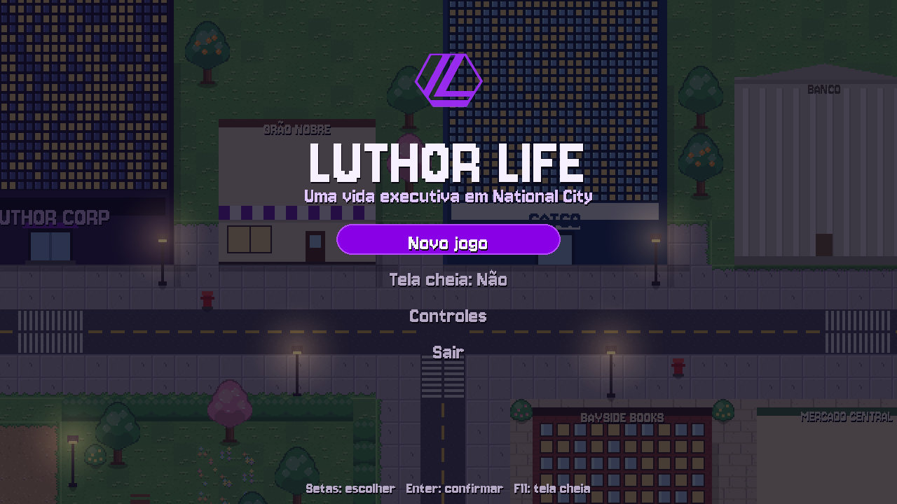
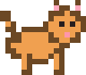
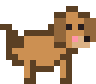
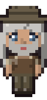
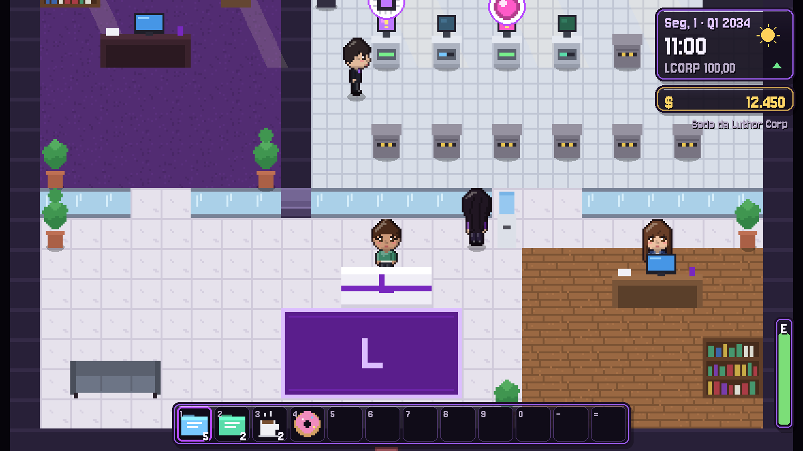
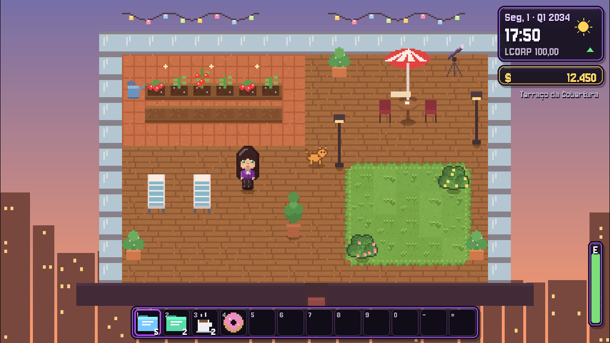
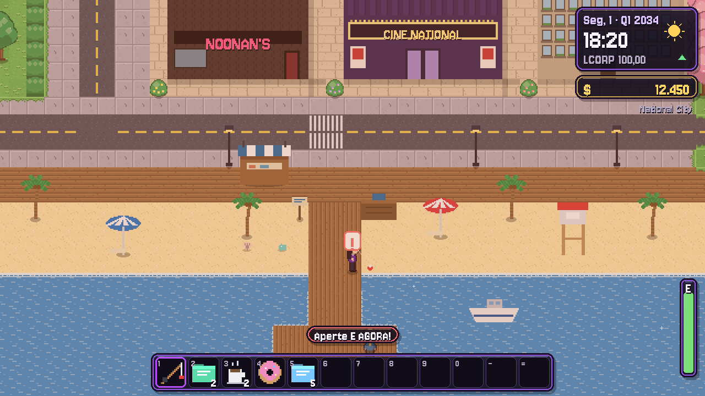
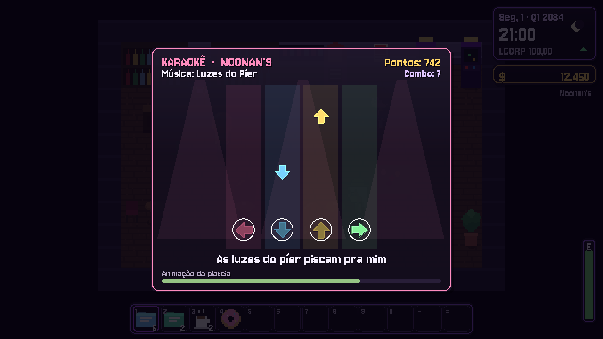
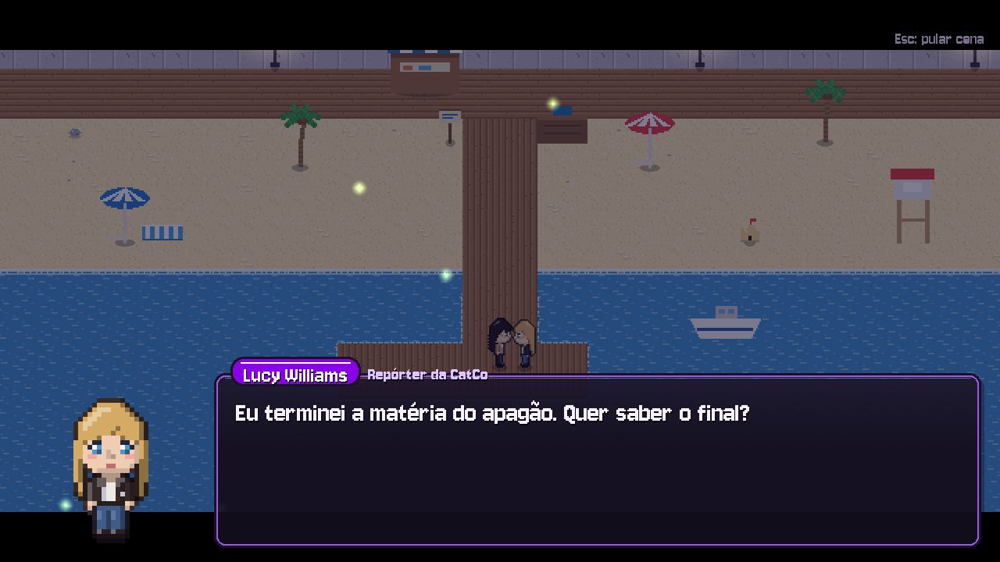
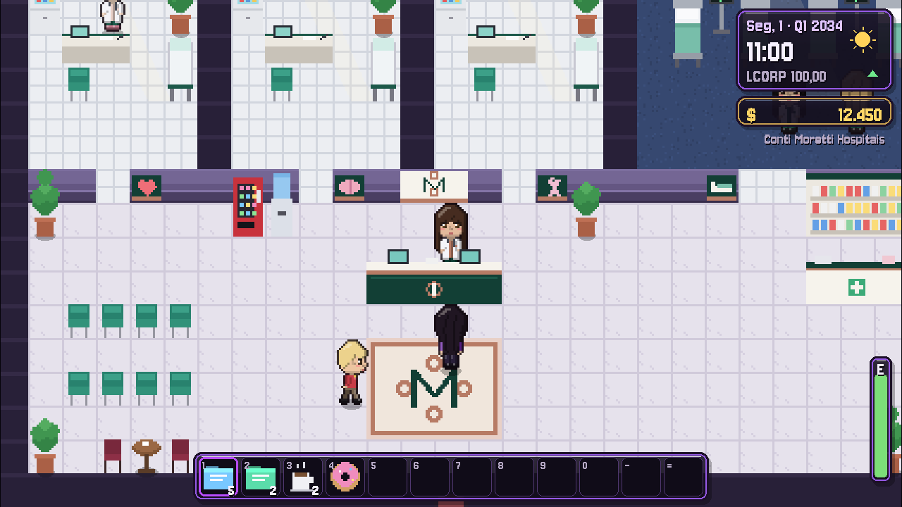

<div align="center">


# Luthor Life

**Uma vida executiva em National City**

Simulação de vida em pixel art, no estilo Stardew Valley, feita em Python.

[](https://luthorw.github.io/Luthor-Life/)
[](https://github.com/LuthorW/Luthor-Life/archive/refs/heads/main.zip)
[](https://www.python.org/downloads/)
[](https://pyga.me/)



           

### [🌐 Conheça o jogo no site](https://luthorw.github.io/Luthor-Life/)

</div>

---

## Sobre

Você é **Letícia Luthor**, CEO da Luthor Corp. Lance projetos no laboratório, pesque no píer, cultive a horta
do terraço, adote um bichinho e encontre o amor numa cidade que vive com você, da manhã até tarde da noite.

Cada dia tem manhã, tarde e noite. A cidade muda de rotina, os moradores entram e saem dos lugares, e você
decide como gastar a sua energia.

## O que fazer

<table>
<tr>
<td width="50%"></td>
<td width="50%"></td>
</tr>
<tr>
<td><b>🧪 Laboratório P&amp;D</b><br>Compre propostas, trabalhe nos projetos todo dia, lance produtos e acompanhe a ação LCORP.</td>
<td><b>🌱 Horta e bichinho</b><br>Plante no terraço da cobertura, regue, colha e adote um gato ou um cachorro.</td>
</tr>
<tr>
<td></td>
<td></td>
</tr>
<tr>
<td><b>🎣 Pescaria</b><br>13 espécies no mar e no lago, que mudam com o trimestre, a hora e a chuva.</td>
<td><b>🎤 Karaokê e fliperama</b><br>À noite no Noonan's: acerte as setas no ritmo e ganhe gorjetas.</td>
</tr>
<tr>
<td></td>
<td></td>
</tr>
<tr>
<td><b>💜 Romance e cutscenes</b><br>Lucy Williams ou Vittoria Ricci: encontros às 20h, eventos de coração e cenas especiais.</td>
<td><b>🏥 Conti Moretti Hospitais</b><br>12 especialidades, médicas com rotina própria e bônus diferentes a cada consulta.</td>
</tr>
</table>

E ainda: **cozinha** com receitas secretas, **coletáveis** na praia e no parque, **Cine National**, **aquário**,
**livros com bônus permanentes**, **pedidos** da cidade e **centenas de falas** que não se repetem.

## Como jogar

1. Instale o [Python](https://www.python.org/downloads/) 3.10 ou mais novo. No Windows, marque **Add Python to PATH**.
2. [Baixe o jogo](https://github.com/LuthorW/Luthor-Life/archive/refs/heads/main.zip) e extraia, ou clone:
   ```bash
   git clone https://github.com/LuthorW/Luthor-Life.git
   ```
3. No Windows, dê dois cliques em **`Jogar.bat`**. Em qualquer sistema:
   ```bash
   pip install -r requirements.txt
   python main.py
   ```

O jogo salva sozinho toda noite, quando você dorme (em `saves/save.json`).

## Controles

| Tecla | Ação |
|---|---|
| `W` `A` `S` `D` / setas | Andar (`Shift` = devagar) |
| `E` / `Espaço` / clique | Interagir, conversar, trabalhar, pescar |
| `1`–`0`, `-`, `=` / roda do mouse | Escolher item da barra |
| `F` / botão direito | Comer, beber ou ler |
| `I` / `Tab` | Mochila |
| `Esc` | Menu: objetivos, relacionamentos, coleções e cenas |
| setas ou `D` `F` `J` `K` | Karaokê |
| `F11` | Tela cheia |

## Dicas

- **Começo:** Relatórios de Mercado são baratos e ficam prontos em 2 dias. O Seu Joca dá uma vara de pesca no píer.
- **Ações:** vender produtos do laboratório faz a LCORP subir (cerca de $1 a cada $800 vendidos numa noite).
- **Romance:** rosas aos 8 corações para namorar, pingente aos 10 para morarem juntas.
- **Conversas:** cada pessoa conversa uma vez por período (manhã, tarde e noite).
- **Durma antes das 2h**, ou você acorda no Conti Moretti com uma conta para pagar.

## Estrutura do projeto

```
Luthor-Life/
├── main.py            # inicia o jogo
├── Jogar.bat          # atalho para Windows
├── assets/            # fonte, logos e retratos
├── docs/              # site do jogo (GitHub Pages)
└── luthor/
    ├── game.py        # núcleo do jogo
    ├── world.py       # mapas de National City (desenhados em texto)
    ├── art.py         # toda a pixel art, gerada por código
    ├── characters.py  # personagens, rotinas, presentes e eventos
    ├── dialogue.py    # falas por período, clima, lugar e amizade
    ├── activities.py  # horta, coletáveis, bichinho, karaokê e cinema
    ├── hospital.py    # Conti Moretti Hospitais
    ├── doctors.py     # as médicas e suas rotinas
    ├── crowd.py       # moradores que circulam pela cidade
    ├── cutscenes.py   # motor de cutscenes
    ├── minigames.py   # pesca, fliperama, fogão e mochila
    └── data.py        # itens, peixes, receitas, livros e lojas
```

Para trocar os retratos, coloque as fotos em `assets/portraits/` e indique o nome do arquivo em
`luthor/characters.py` (campo `portrait`).

## Créditos

Jogo feito por uma pessoa que está cansada da vida real. Personagens e marcas inspirados em obras de terceiros pertencem 
aos seus respectivos donos. Fonte [Jersey 10](https://fonts.google.com/specimen/Jersey+10) sob a SIL Open Font License.

<div align="center"><sub>Feito com 💜 e muitos pixels em National City.</sub></div>
